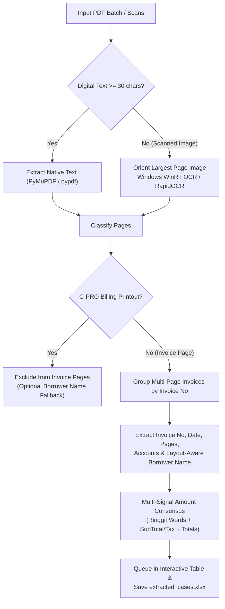
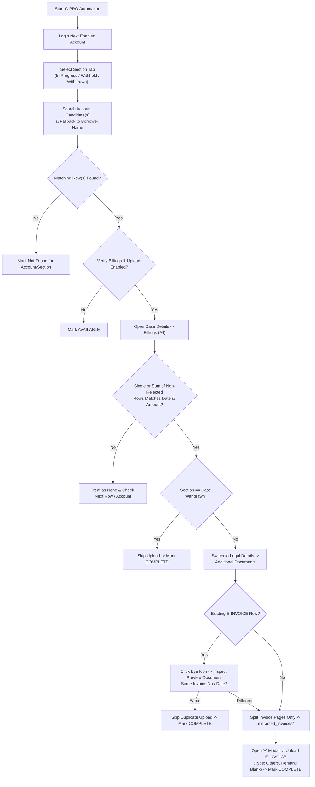

# C-PRO Case Suite

[](https://www.python.org/)
[](https://playwright.dev/)
[](https://github.com/RapidAI/RapidOCR)
[](https://docs.python.org/3/library/tkinter.html)
[](LICENSE)

An intelligent, end-to-end desktop automation suite engineered for legal practitioners and law firms handling bank legal case listings. **C-PRO Case Suite** extracts per-invoice account, borrower, date, and amount details from multi-invoice PDFs (digital or scanned), verifies cases and billing records across multiple logins and sections on the **Hong Leong Bank (HLB) C-PRO Law Firm Portal** (`https://hlbcclo.hlb.com.my/lawfirm/case-listing`), and automatically splits and uploads verified single-invoice PDFs as `E-INVOICE`.

---

## 📑 Table of Contents
- [Overview & Problem Statement](#-overview--problem-statement)
- [Key Features](#-key-features)
- [Application Architecture](#-application-architecture)
  - [1. Intelligent Multi-Invoice PDF Extraction Pipeline](#1-intelligent-multi-invoice-pdf-extraction-pipeline)
  - [2. End-to-End Multi-Account Portal Verification & E-INVOICE Upload](#2-end-to-end-multi-account-portal-verification--e-invoice-upload)
- [User Interface](#-user-interface)
- [Installation & Setup](#-installation--setup)
- [Usage Guide](#-usage-guide)
- [Generated Excel Reports & Extracted PDFs](#-generated-excel-reports--extracted-pdfs)
- [Technical Deep Dive](#-technical-deep-dive)
  - [DevExtreme dxDataGrid Stabilization](#devextreme-dxdatagrid-stabilization)
  - [Billing Verification & Subset-Sum Matching](#billing-verification--subset-sum-matching)
  - [Eye-Preview Duplicate Inspection & Selective PDF Splitting](#eye-preview-duplicate-inspection--selective-pdf-splitting)
  - [Intelligent Session Recovery & Anti-Kickout](#intelligent-session-recovery--anti-kickout)
  - [Resilient File I/O & Locked Workbook Fallbacks](#resilient-file-io--locked-workbook-fallbacks)
- [Security & Compliance](#-security--compliance)
- [Troubleshooting](#-troubleshooting)
- [License](#-license)

---

## 💡 Overview & Problem Statement

Law firms acting on behalf of banking institutions frequently process large scanned PDF batches containing dozens of invoices mixed with printed portal billing histories. Handling this manually presents major bottlenecks:

1. **Multi-Invoice Batch Scanning & Manual Splitting**: Staff must read scanned invoices, separate individual invoice pages from attached billing printouts, and save single-case PDFs manually.
2. **Multi-Account & Multi-Section Lookup**: Cases can sit under different portal accounts (branch/firm logins) and tabs (*Case In Progress*, *Case Withhold*, *Case Withdrawn*), and one borrower may hold multiple loan accounts.
3. **Billing Cross-Checking**: Before uploading an invoice, staff must enter *Case Details* → *Billings* to confirm that non-rejected billing row(s) match the invoice's exact **Date** and **Total Amount** (sometimes split across multiple manual + auto-billing rows on the same date).
4. **Duplicate E-INVOICE Disambiguation**: Existing `E-INVOICE` rows often have blank remarks and generic names, requiring staff to click the **Eye (Preview)** icon to check whether the uploaded PDF is the same invoice or a different one.
5. **Portal Instability & Concurrency Kickouts**: Bank portals invalidate sessions on concurrent access or idle timeouts, interrupting batch runs.

**C-PRO Case Suite** automates the entire workflow end-to-end using local OCR, layout-aware invoice parsing, lossless per-invoice PDF page splitting, and self-healing Playwright browser automation.

---

## 🚀 Key Features

### 👤 Dynamic User-Entered Account Management
- **No Hardcoded Accounts**: Enter any C-PRO username and session password directly in the sidebar.
- **Dynamic Account List**: Add, toggle on/off, or remove (`✕`) as many C-PRO accounts as needed.
- **Safe Username Persistence**: Usernames and enabled states are saved locally in `cpro_saved_accounts.json`.
- **Strict In-Memory Password Protection**: Passwords remain strictly in runtime RAM and are **never** written to disk.

### 🔍 Zero-Setup Scanned PDF & Multi-Invoice Extractor
- **Windows Built-In OCR + Fallbacks**: Reads digital PDF text layers (`PyMuPDF` / `pypdf`) and automatically processes scanned PDFs locally via `pypdf` + `Pillow` + **Windows WinRT OCR** (`Windows.Media.Ocr`)—with `RapidOCR` fallback when installed.
- **Automatic Page Classification & Grouping**: Skips C-PRO *Billing History* printout pages, handles rotated scans (`/Rotate`), and groups multi-page invoices cleanly.
- **Multi-Signal Amount & Metadata Extraction**: Extracts `Invoice No`, `Invoice Date`, `Invoice Amount` (cross-checked via `RINGGIT MALAYSIA` words, `Sub Total + Service Tax`, and totals), `Account No`, `Alt Account No` (paired `&` accounts and credit card `c:` numbers), `Borrower Name`, and exact `Invoice Pages`.

### 🌐 Automated Billing Verification & E-INVOICE Upload
- **Multi-PDF Batch Queue & Sequential One-by-One Execution**:
  - Store and queue multiple invoice PDFs at once (or click **`＋ Queue More PDFs`** while automation is already running to append additional PDF batches).
  - View all queued PDFs together or filter by individual PDF batch via the **PDF Batch Queue** selector bar (`[1/N] <pdf_name> (<rows> · Queued/Running/Completed)`), with optional **Auto-Run C-PRO After PDF Upload**.
  - Runs each queued PDF batch sequentially **one by one** from start to finish (including automatic `CHECK ERROR` recovery for that PDF) and immediately saves that PDF's dedicated Excel report before moving to the next PDF.
- **All-Account & Full-Name Checking per Borrower**: Checks every extracted account number (`Account No` + `Alt Account No`), checks **all** matching rows returned by C-PRO (across grid pagination if needed), and—under `Account No → Fallback to Name`—searches the **full borrower name** (preserving `BIN`, `BINTI`, `A/L`, `A/P`, etc.) if earlier rows fail Billing verification.
- **Billings Tab Date & Amount Verification**: Opens **Case Details** → **Billings** → **Billing History (`All`)**, excludes `Rejected` rows, and matches either a single row or any combination/sum of rows on the exact `Invoice Date`. If no match is found, treats that match as `None` and keeps checking remaining rows, sections, and accounts (`NONE (Billing Mismatch)` if none match).
- **Case Withdrawn Upload Rule**: For **Case Withdrawn**, verifies *Billings* Date & Amount and automatically **skips** uploading `E-INVOICE` (`COMPLETE`, `Skipped upload (Case Withdrawn)`).
- **Eye-Preview Duplicate Check & Targeted PDF Upload**: For **Case In Progress** and **Case Withhold**:
  1. Switches back to **Legal Details** and scrolls to **Additional Documents** (across pagination).
  2. For any existing `E-INVOICE` row, clicks the **Eye (Preview)** icon, inspects the `Preview Document` modal (PDF network/embed bytes or screenshot OCR, with Download fallback), and only skips if it matches the target `Invoice No` / `Date & Amount`.
  3. Otherwise, extracts **only** that invoice's page(s) into `extracted_invoices/` and submits **Add New Document** (`Document Name = E-INVOICE`, `Document Type = Others`, blank `Remark`) before marking the case **`COMPLETE`**.
- **Configurable Verification Toggle**: Toggle **Verify Billings & Upload E-INVOICE** in the sidebar to run the full end-to-end workflow or availability-only checking.
- **Row Controls & Error Recovery**: Interactive row checkboxes (`☑` / `☐`), **`Select All`**, **`Deselect All`**, **`Select Pending`**, **`Select Errors`**, **`☑ Select This PDF`**, **`✕ Remove PDF`**, DPI-aware scrollable double-click row editing (Account, Name, Invoice No, Date, Amount, Source PDF, Pages), and up to 3 automatic `CHECK ERROR` recovery passes per PDF batch.

### 🛡️ DevExtreme dxDataGrid Stabilization & Session Recovery
- **Active XHR & Fetch Tracking**: Monitors in-flight requests and DevExtreme load panels before reading tables.
- **DOM Signature Verification**: Waits for debounced row/empty-state stability to eliminate stale reads.
- **Auto-Dismiss Session Timeout Warning**: Automatically detects C-PRO's `Session Timeout Warning` popup (`"Your session will expire in ... seconds"`) via Playwright's locator handler and polling checks, clicking **`Stay`** immediately to prevent forced logout and click interception.
- **Portal Role-Selection (`LAW FIRM`) Auto-Entry**: Automatically detects when C-PRO logs out to the *"Welcome Back / Sign in to get started"* portal role selector and clicks **`LAW FIRM`** to enter the login page.
- **Anti-Kickout Auto-Recovery**: Detects session kickouts/timeouts (`"Logged in from another location"`, `"Error! Unauthenticated"`), re-authenticates, restores the active section, and continues seamlessly.

### 📊 Per-PDF & Master Excel Output Management
- **Separate Excel Files per PDF**:
  - **Per-PDF Extracted Cases**: `extracted_cases_<pdf_name>.xlsx` is saved immediately as each PDF is scanned/extracted.
  - **Per-PDF Final C-PRO Report**: `cpro_availability_report_<pdf_name>.xlsx` (with `Summary_Report` and `All_Checks_Detail` worksheets for that specific PDF) is saved immediately when each PDF batch completes its C-PRO check.
  - **Master Combined Queue & Report**: Also maintains `extracted_cases.xlsx` and `cpro_availability_report.xlsx` across all queued PDF batches.
- **Lock-Resistant Fallback System**: Automatically saves timestamped fallbacks in writable system folders (`Script Directory` → `Desktop` → `Documents` → `AppData` → `Temp`) if Excel locks the target workbook.

---

## 🏗️ Application Architecture

### 1. Intelligent Multi-Invoice PDF Extraction Pipeline



---

### 2. End-to-End Multi-Account Portal Verification & E-INVOICE Upload



---

## 🖥️ User Interface

1. **Header Bar**: Displays application identity and live status badge (`Ready`, `Extracting PDFs...`, `Checking C-PRO...`, `Re-checking errors...`, `Stopped`).
2. **Left Sidebar**:
   - **C-PRO ACCOUNTS**: Dynamic account cards with enable checkbox, Username, masked Session Password (`•`), **`Show Passwords`**, **`＋ Add Account`**, and **`✕ Remove`**.
   - **SECTIONS TO CHECK**: *Case In Progress*, *Case Withhold*, *Case Withdrawn*.
   - **SEARCH STRATEGY**: *Account No → Fallback to Name*, *Account No Only*, *Borrower Name Only*.
   - **BILLING & UPLOAD WORKFLOW**: Toggle **Verify Billings & Upload E-INVOICE**.
   - **Show Live Chrome Browser**: Watch Playwright live or run headless.
   - **EXCEL FILES & OUTPUTS**: Quick buttons for `extracted_cases.xlsx`, `cpro_availability_report.xlsx`, and the output folder.
3. **Main Content Area**:
   - **Action Bar**: **`＋ Upload & Extract PDFs`**, **`＋ Add Manual Row`**, **`Import Excel`**, **`Clear List`**, **`▶ Start C-PRO Check`**, **`■ Stop`**.
   - **Cases Queue Table**: Columns for `☑`, `#`, `Invoice No`, `Account No`, `Borrower Name`, `Inv Date`, `Inv Amt`, `Pages`, `Status`, `Account(s)`, `Billing Check`, `Upload Status` with color-coded statuses:
     - 🟢 **`COMPLETE`** / **`AVAILABLE`**: Verified & completed (or available in check-only mode).
     - 🔴 **`NOT FOUND`** / **`NONE (Billing Mismatch)`**: Absent or failed Billing verification across all checked rows/accounts.
     - 🔵 **`CHECKING`**: Currently active query.
     - 🟡 **`CHECK ERROR`** / **`BILLING MATCHED (No PDF)`**: Transient search failure or billing match without a linked source PDF.
   - **Live Activity Log & Progress**: Timestamped stream and progress bar.

---

## 📦 Installation & Setup

### Prerequisites
- **Operating System**: Windows 10/11 (recommended for zero-setup built-in Windows OCR), macOS, or Linux.
- **Python**: Version `3.9` or higher.

### 1. Clone the Repository
```bash
git clone https://github.com/ChunJIA614/cpro-case-suite.git
cd cpro-case-suite
```

### 2. Create and Activate a Virtual Environment
```bash
# Windows
python -m venv venv
venv\Scripts\activate

# macOS / Linux
python3 -m venv venv
source venv/bin/activate
```

### 3. Install Dependencies
```bash
pip install -r requirements.txt
```
*(On Windows 10/11, `pypdf` + `pillow` + `pandas` + `openpyxl` + `playwright` are sufficient for scanned PDF OCR and splitting; `pymupdf` and `rapidocr-onnxruntime` are optional fallbacks or needed on macOS/Linux.)*

### 4. Install Playwright Browser Binaries
```bash
playwright install chromium
```

---

## 🚦 Usage Guide

### Starting the Application
- **Via Command Line**: `python cpro_suite_app.py` *(or `py cpro_suite_app.py` on Windows)*
- **Via Windows Launcher**: Double-click `run.bat`.

### Step-by-Step Workflow
1. **Populate Cases Queue**:
   - Click **`＋ Upload & Extract PDFs`** and select one or more multi-invoice PDFs.
   - *Alternative*: Click **`Import Excel`** (supports `Account No`, `Borrower Name`/`Search Name`, plus optional `Invoice No`, `Invoice Date`, `Invoice Amount`, `Source PDF Path`, `Invoice Pages`) or **`＋ Add Manual Row`**.
2. **Review & Select Rows**:
   - Double-click any row to inspect or edit `Account No`, `Search Name`, `Invoice No`, `Invoice Date`, `Invoice Amount`, `Source PDF Path`, or `Invoice Pages`.
   - Use checkboxes or **`Select All`**, **`Deselect All`**, **`Select Pending`**, **`Select Errors`**.
3. **Configure Accounts & Workflow**:
   - Enter C-PRO usernames/passwords, select target sections, choose search strategy, and keep **`Verify Billings & Upload E-INVOICE`** enabled for full automation.
4. **Run Automation**:
   - Click **`▶ Start C-PRO Check`** and monitor live logs.
5. **Inspect Outputs**:
   - Review `cpro_availability_report.xlsx` and uploaded split PDFs in `extracted_invoices/`.

---

## 📈 Generated Excel Reports & Extracted PDFs

- **Split Single-Invoice PDFs**: Saved in `extracted_invoices/<InvoiceNo>_<AccountNo>_p<Pages>.pdf` inside the output directory only for cases that pass Billing verification (and require upload).
- **Queue Workbook (`extracted_cases.xlsx`)**: Persists extracted invoice metadata, source PDF paths, and page ranges across restarts.
- **Final Report (`cpro_availability_report.xlsx`)**:
  - **`Summary_Report`**: `Source File`, `Source PDF Path`, `Invoice Pages`, `Invoice No`, `Invoice Date`, `Invoice Amount`, `Account No`, `Alt Account No`, `Search Name`, `Full Borrower Name`, `Availability Status`, `Found In Account(s)`, `Found In Section(s)`, `Billing Check`, `Upload Status`, `Extracted Invoice PDF`, `C-PRO Row Details`.
  - **`All_Checks_Detail`**: `Invoice No`, `Account No`, `Search Name`, `C-PRO Account`, `Login Used`, `Section`, `Status`, `Matched By`, `Billing Check`, `Upload Status`, `C-PRO Row Details`, `Round`.

---

## 🔬 Technical Deep Dive

### DevExtreme dxDataGrid Stabilization
The HLB C-PRO portal relies on DevExtreme DataGrids (`.dx-datagrid`) with asynchronous XHR/fetch transitions. `_trigger_grid_action_and_wait()` and `_wait_for_section_table()` track active requests, `.dx-loadpanel` visibility, and debounced DOM row/empty-state snapshots before reading grid data.

### Billing Verification & Subset-Sum Matching
In `find_billing_match()`, all `Billing History` pages are scanned under the `All` sub-tab, excluding `Rejected` entries. Monetary values are converted via `Decimal` into exact integer cents to evaluate both single-row matches and subset sums on the target billing date.

### Eye-Preview Duplicate Inspection & Selective PDF Splitting
Before uploading to *Additional Documents*, `_read_additional_docs_rows_and_check_einvoice()` checks paginated rows and clicks the **Eye** icon on any existing `E-INVOICE` row. It inspects the `Preview Document` modal across 4 layers (captured PDF response, `iframe`/`embed`/`object` source fetch, modal screenshot OCR, and Download icon fallback) and compares `Invoice No` / `Date & Amount` before calling `extract_invoice_pdf_pages()` via `pypdf.PdfWriter`.

### Intelligent Session Recovery & Anti-Kickout
`_install_session_timeout_handler()` and `_dismiss_session_timeout_warning()` automatically detect C-PRO's `Session Timeout Warning` modal (`"Your session will expire in ... seconds"`) and click **`Stay`** so long runs are never interrupted or kicked out. In addition, `_is_kicked_or_unauthorized()` monitors URLs, sign-in forms, and toast banners; `_login_and_restore_section()` automatically re-authenticates and restores the active section tab, while `_prompt_for_correct_password()` prevents bank account lockouts on wrong passwords.

### Resilient File I/O & Locked Workbook Fallbacks
`_write_with_fallback()` intercepts `PermissionError` when an Excel report is open in Microsoft Excel and saves a timestamped copy to the first writable output path.

---

## 🔒 Security & Compliance

- **No Remote Credential Transmission**: Credentials and case data communicate solely between your local machine and the official Hong Leong Bank portal.
- **In-Memory Credential Lifespan**: Passwords reside exclusively in memory and are discarded on exit.
- **Local OCR & Processing**: Windows WinRT OCR / RapidOCR and PDF page splitting execute 100% locally without uploading legal invoices to external cloud APIs.

---

## ❓ Troubleshooting

| Issue | Cause | Solution |
| :--- | :--- | :--- |
| **Playwright Missing Error** | Browser binaries not installed | Run `playwright install chromium` in your Python environment. |
| **Grid Load Timeout Error** | Slow portal network response | Check your internet connection or verify HLB C-PRO portal availability. |
| **Missing Username Warning** | An account card is enabled without a username | Enter a username or uncheck / remove (`✕`) the card. |
| **Login Rejected / Invalid Password** | Incorrect password for account | Enter the valid password when prompted. |
| **Output File Locked** | Workbook is open in Excel | Close Excel or check the timestamped fallback path shown in the log. |
| **Missing Amount / Name on Scan** | Clipped scan or missing multi-page scan page | Double-click the row in the Cases Queue to fill/correct the field before running. |

---

## 📄 License

This project is licensed under the [MIT License](LICENSE) - see the LICENSE file for details.
