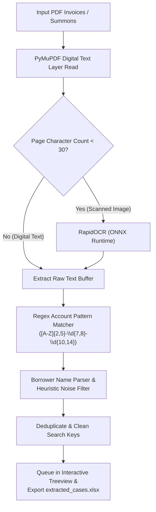
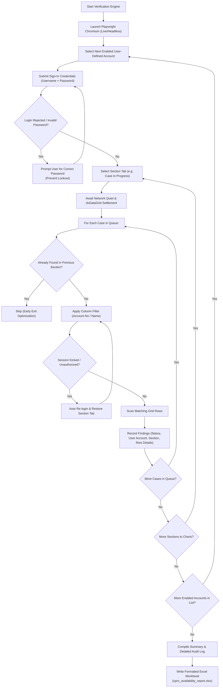

# C-PRO Case Suite

[](https://www.python.org/)
[](https://playwright.dev/)
[](https://github.com/RapidAI/RapidOCR)
[](https://docs.python.org/3/library/tkinter.html)
[](LICENSE)

An intelligent, high-efficiency desktop application engineered for legal practitioners and law firms handling bank legal case listings. **C-PRO Case Suite** streamlines the extraction of borrower and account information from legal documents (PDF invoices, summons, notices) and automates multi-account, multi-section status verification against the **Hong Leong Bank (HLB) C-PRO Law Firm Portal** (`https://hlbcclo.hlb.com.my/lawfirm/case-listing`).

---

## 📑 Table of Contents
- [Overview & Problem Statement](#-overview--problem-statement)
- [Key Features](#-key-features)
- [Application Architecture](#-application-architecture)
  - [1. Intelligent PDF Extraction Pipeline](#1-intelligent-pdf-extraction-pipeline)
  - [2. Dynamic Multi-Account Portal Automation Cycle](#2-dynamic-multi-account-portal-automation-cycle)
- [User Interface](#-user-interface)
- [Installation & Setup](#-installation--setup)
- [Usage Guide](#-usage-guide)
- [Generated Excel Reports](#-generated-excel-reports)
- [Technical Deep Dive](#-technical-deep-dive)
  - [DevExtreme dxDataGrid Stabilization](#devextreme-dxdatagrid-stabilization)
  - [Intelligent Session Recovery & Anti-Kickout](#intelligent-session-recovery--anti-kickout)
  - [Resilient File I/O & Locked Workbook Fallbacks](#resilient-file-io--locked-workbook-fallbacks)
- [Security & Compliance](#-security--compliance)
- [Troubleshooting](#-troubleshooting)
- [License](#-license)

---

## 💡 Overview & Problem Statement

Law firms acting on behalf of banking institutions frequently receive dense batches of PDF fee bills, notifications, and summons requiring cross-referencing against bank case portals. Performing this process manually presents significant challenges:

1. **Repetitive Manual Data Entry**: Staff must manually copy account numbers and borrower names across dozens or hundreds of PDF pages.
2. **Multi-Account Switching**: Firms and legal departments operate under multiple distinct portal accounts (e.g., branch logins, partner credentials, or team accounts), requiring tedious repeated logins.
3. **Multi-Section Tab Traversal**: For each account, legal clerks must check separate portal tabs: *Case In Progress*, *Case Withhold*, and *Case Withdrawn*.
4. **Portal Instability & Concurrency Kickouts**: Bank portals often invalidate sessions unexpectedly or when an account is accessed concurrently, disrupting manual lookups.
5. **Audit Trail Gaps**: Manual checks often lack time-stamped proof of verification across accounts.

**C-PRO Case Suite** solves these challenges by combining **computer vision (OCR)**, **regular expression pattern extractors**, and **adaptive browser automation** into a unified, high-DPI desktop application with **fully customizable, user-defined account management**.

---

## 🚀 Key Features

### 👤 Dynamic User-Entered Account Management
- **No Hardcoded Accounts**: Enter any C-PRO username and session password directly in the interface. Not locked to fixed account names.
- **Dynamic Account List**: Add as many accounts as your organization requires via the `＋ Add Account` button.
- **Individual Enable / Disable Controls**: Easily toggle specific accounts on or off using checkboxes before running searches.
- **One-Click Deletion**: Remove unwanted account entries with a single click (`✕`).
- **Safe Username Persistence**: Configured usernames and their enabled states are saved locally (`cpro_saved_accounts.json`), eliminating the need to retype usernames every session.
- **Strict In-Memory Password Protection**: Passwords remain exclusively in runtime RAM and are **never** written to disk or configuration files.

### 🔍 Intelligent Dual-Engine PDF Extractor
- **High-Speed Native Extraction**: Quickly extracts text layers from digital PDFs using `PyMuPDF` (`fitz`).
- **RapidOCR Fallback for Scans**: Automatically detects scanned or flattened pages (character count < 30) and applies `RapidOCR` with ONNX Runtime at 200 DPI for high-accuracy text recovery.
- **Malaysian Banking Pattern Matching**: Accurately isolates loan account formats (e.g., `UPL-2611339-39596078602`, `MG-2611300-26791032594`).
- **Heuristic Borrower Name Normalization**: Extracts borrower names while filtering out legal fee headers, SV-8 codes, document numbers, and trimming titles (`BIN`, `BINTI`, `A/L`, `A/P`, `@`) to generate clean portal search keys.

### 🌐 Multi-Section Automation Engine
- **Configurable Section Traversal**: Concurrently filters through:
  - *Case In Progress*
  - *Case Withhold*
  - *Case Withdrawn*
- **Flexible Search Strategies**:
  - `Account No → Fallback to Name` (Recommended)
  - `Account No Only`
  - `Borrower Name Only`
- **Early-Exit Optimization**: Once a case is positively identified in an account/section, redundant checks across subsequent accounts for that case are immediately skipped to maximize execution speed.

### 🛡️ DevExtreme dxDataGrid Stabilization & Session Recovery
- **Active XHR & Fetch Tracking**: Monitors underlying asynchronous network calls to prevent querying tables while they are still loading.
- **DOM Signature Verification**: Inspects DevExtreme table rows (`tr.dx-data-row`), header cells, and `.dx-datagrid-nodata` states to ensure the DOM is settled before asserting match/not-found statuses.
- **Anti-Kickout Auto-Recovery**: Intercepts unauthenticated toast popups, expired session dialogs, or simultaneous login kicks (`"Logged in from another location"`, `"Error! Unauthenticated"`), automatically re-authenticates, navigates back to the active section, and resumes the batch queue without manual intervention.

### 📊 Resilient Dual-View Excel Reporting
- **Two Comprehensive Worksheets**:
  1. `Summary_Report`: High-level overview of every case, availability flag, and matching user account / section.
  2. `All_Checks_Detail`: Granular audit log showing exact timestamps, user accounts utilized, sections checked, search query used, and verbatim DevExtreme grid row text.
- **Lock-Resistant Fallback System**: If Microsoft Excel has locked an existing output workbook, the suite automatically falls back to timestamped filenames across safe directories (`Desktop`, `Documents`, `AppData`, or `Temp`), ensuring no data loss.

### 🎨 Apple Human Interface Design Desktop Experience
- Designed with Apple Human Interface Guidelines: crisp neutral palettes, rounded cards, subtle border radiuses, and dynamic status badges.
- **Native High-DPI Scaling**: Crisp typography and controls on modern 2K/4K Windows displays using `SetProcessDpiAwareness`.
- **Integrated Scrollable Containers**: Smooth mousewheel-scrollable account manager that scales gracefully regardless of whether you configure 1 account or 15.

---

## 🏗️ Application Architecture

### 1. Intelligent PDF Extraction Pipeline



---

### 2. Dynamic Multi-Account Portal Automation Cycle



---

## 🖥️ User Interface

The desktop GUI is divided into clear functional zones:

1. **Header Bar**: Displays application identity and a dynamic status badge (`Ready`, `Extracting PDFs...`, `Checking C-PRO...`, `Stopping...`).
2. **Left Sidebar**:
   - **C-PRO Accounts (Dynamic)**:
     - Scrollable list of custom account cards.
     - Each card contains an enable checkbox, Username entry, session Password entry (`•`), and a delete button (`✕`).
     - **`＋ Add Account`** button to dynamically add new account cards.
     - **`Show Passwords`** toggle to reveal/hide typed passwords.
   - **Sections to Check**: Checkboxes for *Case In Progress*, *Case Withhold*, and *Case Withdrawn*.
   - **Search Strategy**: Radio selector for fallback behavior.
   - **Live Browser Toggle**: Option to view or hide Chromium during automation.
   - **Excel Utilities**: One-click launchers for the extracted queue file, final report, and output folder.
3. **Main Content Area**:
   - **Action Bar**: Buttons to upload PDFs, add manual entries, import external Excel files, clear list, start C-PRO check, or stop automation.
   - **Cases Queue Table**: Interactive table with color-coded row status:
     - 🟢 **AVAILABLE**: Case found in portal.
     - 🔴 **NOT FOUND**: Case verified absent.
     - 🔵 **CHECKING**: Currently active query.
     - 🟡 **CHECK ERROR**: Encountered an error during search.
   - **Live Activity Log & Progress**: Real-time timestamped event stream with percentage progress bar.

---

## 📦 Installation & Setup

### Prerequisites
- **Operating System**: Windows 10/11, macOS, or Linux.
- **Python**: Version `3.9` or higher installed.

### 1. Clone the Repository
```bash
git clone https://github.com/ChunJIA614/cpro-case-suite.git
cd cpro-case-suite
```

### 2. Create and Activate a Virtual Environment
```bash
# Windows
python -m venv venv
venv\Scripts\activate

# macOS / Linux
python3 -m venv venv
source venv/bin/activate
```

### 3. Install Dependencies
```bash
pip install -r requirements.txt
```

### 4. Install Playwright Browser Binaries
Playwright requires the Chromium browser binary to control the web session:
```bash
playwright install chromium
```

---

## 🚦 Usage Guide

### Starting the Application

- **Via Command Line**:
  ```bash
  python cpro_suite_app.py
  ```
  *(or `py cpro_suite_app.py` on Windows)*

- **Via Windows Launcher**:
  Double-click `run.bat` in the repository root folder.

### Step-by-Step Workflow

1. **Populate Cases Queue**:
   - Click **`＋ Upload & Extract PDFs`** to select one or multiple PDF fee invoices/summons.
   - *Alternative*: Click **`Import Excel`** to ingest an existing spreadsheet with `Account No` and `Search Name` columns.
   - *Alternative*: Click **`＋ Add Manual Row`** to type an individual account directly.
2. **Review & Adjust**:
   - Double-click any row in the queue table to manually correct an account number or borrower name before executing searches.
3. **Enter Your Accounts & Passwords**:
   - In the **C-PRO ACCOUNTS** sidebar section, enter your C-PRO username(s) and password(s).
   - Click **`＋ Add Account`** to add additional accounts, or click **`✕`** to remove accounts.
   - Uncheck any account you wish to skip for the current run.
   - Select your target sections (e.g., *Case In Progress*).
   - Select your desired search strategy (default: *Account No → Fallback to Name*).
4. **Run Automation**:
   - Click **`▶ Start C-PRO Check`**.
   - If any enabled account is missing a password, a prompt will appear asking for it.
   - Monitor live progress in the activity log and queue table.
5. **View Results**:
   - Once completed, the output folder will open automatically.
   - Review `cpro_availability_report.xlsx` or click the sidebar shortcuts.

---

## 📈 Generated Excel Reports

The output report (`cpro_availability_report.xlsx`) is structured into two purpose-built sheets:

### Sheet 1: `Summary_Report`
Provides an executive overview of all checked cases:
| Column Header | Description |
| :--- | :--- |
| `Source File` | Originating PDF or Excel file name |
| `Account No` | Extracted bank loan account number |
| `Search Name` | Cleaned primary borrower search string |
| `Full Borrower Name` | Complete extracted borrower name |
| `Availability Status` | `AVAILABLE`, `NOT FOUND`, or `CHECK ERROR` |
| `Found In Account(s)` | Which user account(s) held the case (e.g., `USER_A, USER_B`) |
| `Found In Section(s)` | Specific portal section tabs (e.g., `USER_A: Case In Progress`) |
| `C-PRO Row Details` | Key details extracted from matching DevExtreme grid row |

### Sheet 2: `All_Checks_Detail`
Maintains an exhaustive, timestamped audit log of every query attempted:
- Records individual search terms, exact user accounts utilized, target sections, matching method (`Account No` vs `Borrower Name`), and verbatim grid row contents.

---

## 🔬 Technical Deep Dive

### DevExtreme dxDataGrid Stabilization
The HLB C-PRO portal utilizes DevExtreme DataGrids (`.dx-datagrid`) that rely on client-side XHR/fetch queries. Naive scrapers often read empty or stale table states during async transitions.

C-PRO Case Suite implements a multi-stage synchronization loop:
- **XHR Monitoring**: Hooks into Playwright page events (`page.on('request')`, `page.on('requestfinished')`) to ensure no asynchronous calls are in flight.
- **Snapshot Hashing**: Computes a continuous hash of visible row contents (`.dx-data-row`), header cells, and empty-state banners (`.dx-datagrid-nodata`).
- **Debounced Settlement**: Requires the grid signature to remain strictly stable for at least 1.25s before evaluating data rows.

### Intelligent Session Recovery & Anti-Kickout
Bank portals frequently terminate active sessions due to idle timeouts or simultaneous logins. The suite features self-healing automation:
1. `_is_kicked_or_unauthorized(page)` constantly monitors page URLs, toast error banners (`.toast-close-button`), and authentication modals.
2. When a kickout occurs, the engine intercepts the condition, executes `_login_and_restore_section(page, acc, section)`, re-authenticates the account, navigates back to the current section tab, and retries the failed search without aborting the queue.
3. If bad credentials are submitted, an interactive dialog (`simpledialog.askstring`) prompts the operator for a corrected password rather than repeatedly failing and causing a bank account lockout.

### Resilient File I/O & Locked Workbook Fallbacks
If an operator has `cpro_availability_report.xlsx` open in Microsoft Excel, standard Python file writers raise `PermissionError`. 

The suite wraps all save routines with `_write_with_fallback()`:
- Automatically detects file locks.
- Discovers writable system paths (`Script Directory` → `Desktop/Output` → `Documents/Output` → `AppData` → `Temp`).
- Saves files under timestamped variants (e.g., `cpro_availability_report_20261101_190500.xlsx`) and informs the user via the live activity log.

---

## 🔒 Security & Compliance

- **No Remote Credential Transmission**: Passwords and case details are processed exclusively between your local machine and the official Hong Leong Bank portal.
- **In-Memory Credential Lifespan**: All passwords entered into the GUI reside strictly in memory and are discarded when the application window is closed. No passwords are ever saved to disk.
- **Non-Sensitive Config Storage**: Only account usernames and their enabled states are saved to `cpro_saved_accounts.json` for user convenience.
- **Local OCR & Processing**: Text extraction and OCR are executed locally on CPU/ONNX Runtime without uploading legal documents to third-party cloud APIs.

---

## ❓ Troubleshooting

| Issue | Cause | Solution |
| :--- | :--- | :--- |
| **Playwright Missing Error** | Browser binaries not installed | Run `playwright install chromium` in your activated Python environment. |
| **Grid Load Timeout Error** | Slow portal network response | Verify your internet connection. Check if HLB C-PRO portal is under maintenance. |
| **Missing Username Warning** | An account card is enabled without a username | Enter a username for the account, or uncheck / remove it (`✕`). |
| **Login Rejected / Invalid Password** | Incorrect password for account | The app will prompt you to enter the correct password. Ensure you are using the active C-PRO credentials. |
| **Output File Locked** | Excel file is open in Microsoft Excel | Close the file in Excel, or find the fallback report in the opened output folder. |
| **PDF Extraction Misses Name** | Unusual formatting in PDF | Double-click the row in the Cases Queue to manually edit the search name before starting the check. |

---

## 📄 License

This project is licensed under the [MIT License](LICENSE) - see the LICENSE file for details.
